# Tuda · 图塔

面向电商视觉创作的桌面无限画板。把商品图、参考图和生成结果放在一起比较、整理，再让当前使用的 Agent 通过 CLI 操作同一工作区。



## 核心能力

- 独立的画板、图片导入、粘贴、移动、缩放、分组及排列。
- 本地保存、版本比较、素材管理和画板包导入导出。
- `tuda` CLI 与 `using-tuda` 配套 Skill；支持显式、可组合的画板操作。
- 接入用户自行配置的图片、视频及对话模型。模型费用由对应服务商收取。

客户正式版面向 Windows；macOS 用于桌面 Dev 开发。画板、素材与配置保存在当前用户自己的电脑。普通本地画板操作可独立使用。

## Agent 使用入口

安装 npm 版本发布后，可向当前使用的 Agent 发送：

> 安装 @petercjl/tuda，并安装你自己的配套 Skill。

> 用 Tuda 将我附上的图片放到一张画板中，按两列排列。

> 更新 @petercjl/tuda，并同步你自己的配套 Skill。

Skill 和 CLI 的能力发现、校验、恢复及授权规则由工具承接。正式桌面更新由应用内的“检查更新”入口完成。npm 包发布与实机支持状态见验收记录。

## 开发

Node.js 22.12+、pnpm 10；macOS 原生组件需要 Xcode Command Line Tools。

```bash
pnpm install --frozen-lockfile
npm ci --prefix cli
pnpm electron:dev
```

开发数据位于项目 `tmp/desktop-dev/user-data/`。正式 Windows 应用使用当前用户的 Tuda 应用数据目录，与原版隔离。

- [完整改造计划](docs/tuda-transformation-plan.md)
- [开发与交付说明](docs/tuda-development.md)
- [CLI 契约](cli/README.md)
- [npm 安装说明](cli/INSTALL.md)
- [npm 更新说明](cli/UPDATE.md)

## 来源与许可

Tuda 基于 [Iterlay](https://github.com/Davied-H/iterlay) 的 MIT 开源代码持续开发，维护自己的 [Fork](https://github.com/petercjl/iterlay)，保留上游同步关系。上游版权与第三方声明见 [LICENSE](LICENSE) 和 [THIRD_PARTY_NOTICES.md](THIRD_PARTY_NOTICES.md)。
