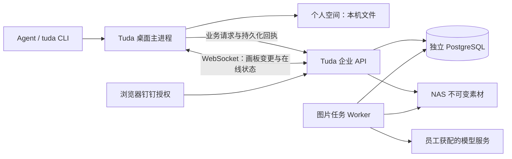

# Tuda NAS 协同实现记录（独立认证版本）

日期：2026-11-12。本文记录 NAS 独立认证及 worker 模式的实现和验收依据。共用公司登录、桌面 Agent、生图及 NAS/本地存储的现行边界见 [公司授权与模型能力](tuda-shared-account-models.md)。历史验收见 [验收记录](tuda-enterprise-acceptance.md)，部署见 [企业服务说明](../enterprise/README.md)。

## 产品与职责

Tuda 提供个人空间和企业空间。个人画板、素材和模型设置由本机原有存储管理；企业画板、素材、成员权限、图片任务和员工模型凭证由独立 NAS 服务管理。登录成功后默认进入企业空间，可以主动切换回个人空间。

钉钉仅承担组织身份认证。Tuda 使用独立的企业内部应用、服务会话、数据库、Docker 网络、文件目录和加密主密钥。管理员按员工分配图片和对话服务，服务端使用发起人的凭证调用相应模型。组织标识、部署地址、管理员身份及秘密配置保存在源码与分发包之外。

## 服务和数据结构

Compose 管理 `server`、`worker`、`db` 三个容器。API 与 WebSocket 在同一服务中运行，worker 单独运行。PostgreSQL 保存 Yjs 文档快照、更新日志、业务回执、成员和会话、任务及审计记录；素材使用独立挂载目录，文档引用 `tuda-enterprise:<assetId>`。

个人空间保持原有 `BoardStore` 文件后端。企业业务复用同一领域操作，通过 `BoardPersistenceAdapter` 接入 PostgreSQL 和 Yjs。桌面与 CLI 进入相同的主进程路由，企业操作执行服务端权限检查。

## 身份、会话和模型凭证

1. 桌面申请五分钟登录事务；服务端生成随机 state 和独立 verifier，只保存哈希。
2. 浏览器进入钉钉 OAuth，申请 `openid corpid`；应用开通 `Contact.User.Read`。
3. 回调在服务端交换授权码，核对返回的 CorpId，再读取用户个人信息并以 unionId 建立稳定 Tuda 身份。
4. 首位管理员由部署配置指定。普通员工默认角色可配置为 editor 或 viewer；管理员可以调整角色及停用成员。
5. 桌面以本次 verifier 取得独立 Tuda 会话。会话有效期十二小时，服务端仅存 token 哈希；桌面以 Electron safeStorage 加密保存，会话令牌不会进入渲染层状态或素材 URL。
6. 每次 API 请求与 WebSocket 消息核对本地成员状态；连接定期复核会话，管理员撤权会主动关闭受影响连接。

组织归属在钉钉授权登录时核验。当前成员停用由 Tuda 管理员执行；钉钉离职事件订阅与自动通讯录复核属于后续集成。会话到期需要重新授权。

管理员在“企业成员与权限”中为员工配置 image/text 服务地址、模型和 API Key。API Key 以 AES-256-GCM 加密，绑定组织、员工与服务种类；接口只返回服务状态、地址和模型。图片任务在提交时固定加密的服务配置，避免队列等待期间切换空间或修改分配而改变任务使用的凭证。可显式配置部署级默认模型，员工分配优先；当前开发部署使用逐员工分配。

## 协同、保存和撤销

实现采用 Yjs 与自定义 WebSocket 网关。共享节点、连线、分组和画板元数据；文本及代码字段使用 Y.Text，x/y 位置作为原子 pose 更新。缩放和视口按用户、画板保存，光标与选中项是绑定真实身份的临时状态，并按当前画板筛选。

客户端按自己观察到的版本生成增量，通过已鉴权 HTTP 业务接口提交。服务端在 PostgreSQL 事务内合并和持久化，提交后才发送 WebSocket 通知。请求 UUID、参数哈希和结果回执保证相同请求可恢复；同一 UUID 携带不同参数会被拒绝。远端变更先等待当前窗口保存，再刷新视图；拖动期间延迟刷新。

本地 UndoManager 仅追踪自己的修改来源，远端更新不进入本人的撤销栈。画板删除和恢复后使用新的 epoch，旧客户端增量无法跨恢复边界写回。

待确认的画板增量保存在按服务、组织和用户隔离的本机 outbox，获得服务端回执后才移除；重连重放相同的原始增量与请求 UUID。连续保存会携带自己尚未被界面观察到的因果前序，避免多次离线修改同一字段退回较早值；前序在对应持久化版本被界面观察后释放。客户端展示连接状态和待同步数量。冲突或权限拒绝会保留待同步材料，不能把失败记录当成成功保存。当前离线能力覆盖已打开画板的编辑和重连；完全离线启动后的画板浏览尚未实现。

## 素材与任务

图片上传验证类型、真实文件头、尺寸与大小，随后登记归属。下载需要 Tuda 会话；桌面使用自己的受控素材协议与分区缓存，缓存文件不会成为个人素材记录。个人画板可以复制到企业空间，原本机画板保留；企业画板支持归档导入导出、单图和 ZIP 下载。

企业图片任务进入 PostgreSQL 队列，独立 worker 在桌面关闭后继续工作。输入固定发起员工、画板、模型、参考图像素、输出节点 ID 和编辑目标；结果统一追加到协同文档或版本链。界面和 worker 共享输出身份，避免重复结果。参考图保持原始像素语义。

只有排队任务可以明确取消。工作进程中断或远端提交结果未知时标记 unknown，系统不会自动重复计费请求。当前服务适配 OpenAI-compatible 图片生成与参考图编辑，需要返回 base64 图片；异步模型任务协议、仅 URL 结果和其他服务商专有参数需要对应适配。

## Agent 与 CLI

CLI 继续连接本机 loopback 服务。`get_space` 查询所选空间、用户角色、连接和待同步状态，`select_space` 切换桌面空间；工作台操作支持显式 `space: personal|enterprise` 参数。一次操作及其异步后续固定执行空间，设置读取不会随界面切换而变化。未指定 space 的独立新调用采用调用开始时的桌面空间。

图片移动、缩放、布局、复制、版本操作、文字与 Canvas 代码写入走同一企业业务层。企业操作未接入的功能会明确拒绝，保持存储边界。

## 部署与恢复

当前完成内网开发部署，HTTP/WS 通过 `TUDA_ALLOW_HTTP_LOGIN=true` 显式开启。正式员工部署应配置客户端可达的 HTTPS/WSS 和对应钉钉回调，再关闭 HTTP 开发选项。数据库端口不映射到主机。

备份先生成一致性数据库快照，再归档不可变素材，配套保存运行配置、Compose、镜像身份和校验清单。运行配置包含恢复所需主密钥，因此备份目录与文件分别限制为 700/600。已在独立临时数据库验证恢复，生产恢复前应停止写入并保留当前恢复点。

## 当前交付边界

Mac Dev 已完成真实登录与双桌面协作验证，Windows 交叉系统验收属于正式发布前的工作。当前企业入口覆盖画板、图片素材、基础生成与编辑、模型分配、CLI 和权限；视频/音频任务、场景库、模板写入、评论标签、漫剧计费与图片交付等专门业务尚未接入企业服务。已存节点可以随画板文档同步，相关专门操作会明确提示。

后续重点包括 HTTPS 域名、两名真实员工与 Windows 联合验收、专门业务适配、完全离线浏览、离职自动回收和持续备份调度。本次没有正式打包 Windows 或发布 npm。
