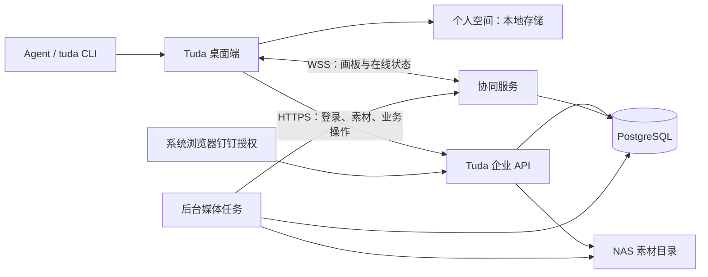

# Tuda 个人空间与 NAS 企业协同空间方案

日期：2026-11-12。状态：需求与技术设计，尚未实现企业登录、部署服务或完成协同验收。

## 1. 已确认的产品要求

- 桌面应用同时提供个人空间和企业空间。个人空间数据保存在当前用户电脑；企业空间的正式数据保存在绿联 NAS。
- NAS 支持 Docker。已有 SSH 接入已验证，系统为 Linux x86_64，Docker 可用；部署使用独立项目、网络和数据目录，保留现有服务。
- 钉钉用于身份认证；企业空间只接受指定钉钉组织的有效成员。组织白名单使用服务端配置的 CorpId。
- 登录成功且通过成员核验后，默认进入企业空间；用户可主动切换个人空间。
- 企业画板支持多人同时查看、编辑、查看在线成员及断线重连。Mac 用于桌面 Dev 验证，正式客户版本面向 Windows。
- Agent 和 `tuda` CLI 与桌面应用操作相同的空间、权限和协同文档。

部署地址、组织标识、钉钉应用凭证和管理员身份存放在部署配置中。具体环境发现记录仅保存在本机忽略目录，不进入公共源码或 npm 包。

## 2. 当前实现与改造位置

当前工作区位于 Electron `userData/workspace`，由本机主进程统一创建存储对象。`electron/storage/board-store.ts` 保存画板快照，`asset-store.ts` 管理实际文件，`atomic-json.ts` 的队列协调本机进程中的写入。节点中的 `imagePath`、`videoPath` 等字段包含文件路径。

前端的 `src/features/boards/use-board-persistence.ts` 和 `src/lib/board-save-coordinator.ts` 负责整板保存。画板视图位于 `src/components/canvas/CanvasBoard.tsx`，撤销历史位于 `canvas-history.ts`。现有快照合并用于本机保存冲突处理，企业实时协同需要明确的共享文档和网络协议。

新增空间路由层，复用现有画板组件与业务操作：个人空间连接本地存储，企业空间连接服务端。企业画板由协同文档驱动，整体 JSON 快照用于导入、导出和派生视图。

## 3. 服务结构

部署使用 Docker Compose 管理 `tuda-server`、`tuda-worker` 和独立 PostgreSQL；HTTPS/WSS 入口优先接入已有反向代理。API 与协同网关初期可放在同一个服务进程，媒体任务使用独立 worker，避免占用交互服务。

数据库与素材分别挂载 NAS 本机持久化目录。桌面客户端通过 API 访问数据，PostgreSQL 数据目录由服务进程在 NAS 本机使用。正式数据库、开发数据库与现有服务数据库隔离。素材先使用普通受管文件目录，保留未来扩展对象存储的接口。

NAS 容器通过内网或已有 VPN 访问；登录回调配置与客户端可达的 HTTPS 地址一致。最终域名、端口、证书及访问范围在部署前检查，不因登录接入自动开放 NAS 管理入口。

## 4. 钉钉登录和组织限制

1. 桌面端向企业服务申请短期登录事务，并打开系统浏览器进行钉钉网页授权。
2. 服务端生成并核验随机 `state`，绑定登录事务。钉钉回调到企业服务，由服务端交换授权码并读取必要身份信息。
3. 服务端针对配置的 CorpId 核验企业内用户身份、有效成员状态及应用授权范围。个人身份授权成功与企业准入分别判断。
4. 使用稳定的钉钉身份映射 Tuda 用户和组织成员记录；组织名称用于显示，CorpId 用于组织准入。员工身份、成员角色和个人身份分别存储。
5. 通过校验后，桌面端用本次登录事务的一次性凭据取得自己的 Tuda 会话。浏览器跳转和 `tuda://` 唤醒链接仅携带一次性状态，不携带长期令牌。
6. 创建或恢复企业成员关系，默认打开企业空间。初始化管理员由部署配置明确指定；普通成员角色由企业策略确定。
7. 会话到期、成员移除或管理员撤销权限后，API 与已建立的协同连接均执行失效处理。通过定期成员复核或事件通知保持成员状态有效。

钉钉应用需要在企业后台配置身份授权、回调地址、成员核验所需权限和应用可见范围。已有 `dws` 登录仅用于核对目标组织，不作为 Tuda 的登录应用或员工长期会话来源。具体接口、应用权限及令牌流程在登录接入验证中按当前钉钉能力确认。

AppSecret 和钉钉服务端令牌只存放在服务端秘密配置；桌面端的 Tuda 会话使用操作系统安全存储。个人空间可在未登录企业时继续本地使用。

## 5. 多人实时协同

拟采用 **Yjs + WebSocket**，使用 Hocuspocus 作为房间、连接和鉴权的基础，增加 Tuda 的文档校验及持久化回执。每个房间由 `organizationId + spaceId + boardId` 定位，服务端逐次验证归属和权限。

### 共享状态与个人状态

| 内容 | 存储与同步规则 |
| --- | --- |
| 节点、连线、分组、图层及展示属性 | Yjs 文档，按稳定 ID 与字段同步 |
| 文本节点和 Canvas 代码 | 使用共享文本类型，适配现有编辑器 |
| 图片与视频 | 文档只保存素材 ID、版本和展示信息；二进制走素材接口 |
| 在线成员、光标、选中项、拖动提示 | Awareness 临时状态；服务端绑定真实成员身份 |
| 个人缩放、视口、面板开关 | 按用户和画板在本地保存；跟随他人视角是显式操作 |
| 权限、账号、任务状态、模型凭证 | 服务端受控业务状态，独立于客户端可编辑文档 |

同步节点变更，避免每次拖动发送整板。将位置的 x/y 作为一个原子姿态值更新；拖动中限频同步，结束时提交最终位置。不同对象可同时编辑；同一字段的并发修改遵循 Yjs 合并规则，界面展示他人正在编辑的信息。CRDT 的一致性不代替产品上的冲突展示、删除语义和数据校验。

撤销使用按本地操作来源隔离的历史；远端更新不进入当前用户的普通撤销栈。删除、删除后的并发更新、恢复与素材引用需要专门定义和测试，避免旧客户端重新提交数据时复活已删除对象。

### 服务端权限和持久化

- 每次连接、重连和写入检查组织、成员及画板权限。只读连接可接收更新和在线信息，不能提交文档写入。
- 权限变更主动通知并更新现有连接；成员身份不能由客户端 Awareness 数据决定。
- 检查更新大小、节点字段、素材归属、schema 兼容性与操作频率，保护服务端受控字段。
- PostgreSQL 保存 CRDT 更新日志与压缩快照；定期合并日志，维护序号和 schema 版本。
- 客户端区分“本机已保存”“等待同步”“企业服务已持久化”。WebSocket 已连接或 Yjs 已完成一次同步不等于更新已经写入数据库。
- 设计持久化确认回执：更新 ID、去重、数据库提交及确认序号形成闭环；本地待同步记录在获得确认后释放。Hocuspocus 默认延迟快照写入需要补充这一契约。
- 文档恢复从快照与更新日志重建；SQL 中用于列表和检索的内容是明确的派生索引，避免同一画板字段存在两套独立写入来源。

## 6. 素材、任务与 CLI

**素材身份。** 企业节点使用 `assetId`、`versionId` 等稳定引用，客户端和服务端分别解析受管路径。上传接口完成流式写入、大小与类型检查、哈希校验及登记后再允许引用。下载和缩略图接口检查空间权限，视频支持范围读取。个人绝对路径只在本机适配层使用。

**本地缓存。** 按服务实例、组织、空间和登录用户分区；退出、换账号和权限撤销时执行缓存策略。断线时显示缓存和待同步状态，重连重新鉴权。已失去权限的更新不写回企业数据，按企业策略保留本地恢复材料或处理，界面说明结果。

**生成任务。** 企业任务使用持久化队列及幂等键，提交时固定空间、画板、发起人、模型和输入。worker 生成文件后登记素材，通过协同服务追加结果，所有在线成员看到同一任务。桌面关闭后任务可以继续。企业模型配置、调用权限和用量归属由服务端管理；个人调用保持本地能力。

**CLI。** 保留本机 loopback 入口，主进程负责空间路由。增加空间发现和显式选择能力；长期任务及 Agent 会话固定空间，不随用户临时切换界面而改变目标。企业写入通过受控业务操作进入同一协同文档，避免本地整板保存覆盖远端变更。CLI 不能靠传入其他企业 ID 越权。

**空间迁移。** 个人画板复制到企业空间时，上传关联素材、建立 ID 映射、校验完整性后一次性导入文档；保留原个人画板。企业空间复制到个人空间受导出权限控制。仅切换空间不自动复制数据。

## 7. 实施工作项与验收

- [ ] 建立空间、身份、成员、素材和协同文档契约，保留个人空间兼容。
- [ ] 实现独立企业服务、数据库迁移、素材目录及 Docker 开发环境。
- [ ] 完成钉钉真实登录、指定组织成员准入、退出、权限撤销及管理员初始化验证。
- [ ] 接入画板共享文档，覆盖图片、文本、连线、分组和现有节点类型；未知 schema 提供兼容处理。
- [ ] 实现在线成员、光标、选中项、多人编辑、个人视口和本地撤销。
- [ ] 实现持久化确认、断线重连、重复消息处理、进程异常恢复及权限变更。
- [ ] 接入素材 ID、本地缓存、批量上传、个人画板复制与导入导出。
- [ ] 将企业任务、Agent 和 CLI 接入统一空间、权限与协同通道。
- [ ] 在 NAS 独立部署，验证 HTTPS/WSS、重启保留数据、备份和还原。
- [ ] 使用两个真实登录用户和两个桌面实例验收：同时查看、同时编辑不同对象、同时编辑相同对象、删除与修改并发、撤销、只读拦截和断线恢复。
- [ ] 在 Windows 与 Mac 间验证同一企业画板、素材、CLI 布局、生成结果和保存状态一致。
- [ ] 验证非目标组织、失效成员、越权房间、跨空间素材引用及重连后的权限拒绝。

性能目标在明确同时在线人数、活跃画板数量、单板节点量和 NAS 资源后设定，以双客户端可复现测试及真实环境测量作为验收证据。

## 8. 运维与未决配置

PostgreSQL 做一致性备份，素材目录配套备份，并保留可核对的素材清单与恢复点；NAS 快照与数据库备份各自承担恢复职责。新增服务先完成独立目录和端口检查，再部署到现有 Docker 环境。

部署前仍需确定：Tuda 专用钉钉内部应用、回调域名、应用权限、初始管理员、NAS 数据目录、反向代理入口及企业成员默认角色。这些配置不影响先完成本地服务与双客户端协同原型。

## 9. 技术参考

- [钉钉：网页方式登录应用](https://open.dingtalk.com/document/orgapp/tutorial-obtaining-user-personal-information)：应用接入及授权流程入口，接口细节需在当前开发者后台核对。
- [Yjs 共享数据类型](https://docs.yjs.dev/getting-started/working-with-shared-types)：共享 Map、Array、Text 和事务。
- [Yjs Awareness](https://docs.yjs.dev/api/about-awareness)：临时在线状态。
- [Yjs UndoManager](https://docs.yjs.dev/api/undo-manager)：按操作来源管理撤销。
- [Hocuspocus 鉴权](https://tiptap.dev/docs/hocuspocus/guides/authentication)：连接鉴权与只读连接。
- [Hocuspocus 服务端钩子](https://tiptap.dev/docs/hocuspocus/server/hooks)：文档载入与持久化扩展；Tuda 仍需实现自己的持久化确认契约。
